<p align="center">
  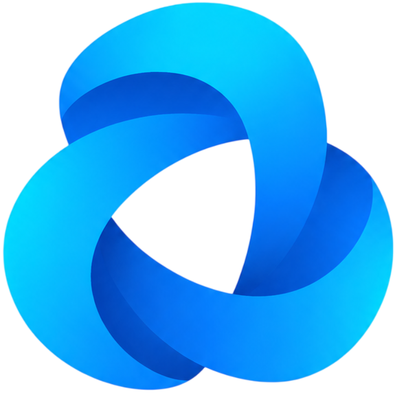
</p>

<h1 align="center">Open Attack Surface Management (OASM)</h1>

<p align="center"><strong>Open-source Attack Surface Management. Discover assets. Identify exposure. Own your security data.</strong></p>

<p align="center">
  <a href="https://github.com/oasm-platform/open-asm/releases"></a>
  <a href="https://github.com/oasm-platform/open-asm/actions/workflows/build-nightly.yml"></a>
  <a href="https://hub.docker.com/r/oasm/oasm-api"></a>
  <a href="https://discord.gg/fWqbNHXR8H"></a>
  <a href="https://www.linkedin.com/company/oasm-platform"></a>
  <a href="https://x.com/OasmPlatform"></a>
  <a href="https://docs.oasm.io"></a>
</p>

OASM is a self-hostable, open-source Attack Surface Management platform. It inventories internet-facing assets, runs distributed scans through pluggable connectors, and tracks the resulting vulnerabilities in one workspace, with AI Studio — a security agent that works directly on that data. Security teams stop stitching together spreadsheets, one-off scanners, and hosted-only tools.

📖 **Documentation → [docs.oasm.io](https://docs.oasm.io)**

## Table of Contents

- [Overview](#overview)
- [Key Features](#key-features)
- [AI Studio](#ai-studio)
- [Architecture](#architecture)
- [Connectors](#connectors)
- [Integrations](#integrations)
- [Screenshots](#screenshots)
- [Quick Start](#quick-start)
- [Development](#development)
- [Contributing](#contributing)
- [Security](#security)
- [Community and Resources](#community-and-resources)
- [License](#license)

## Overview

External attack surface grows faster than teams can track: forgotten subdomains, exposed ports, outdated frameworks, leaked URLs, misconfigured cloud assets. Point scanners answer one question at a time; hosted ASM tools answer them but keep your asset data on someone else's infrastructure.

Attack Surface Management (ASM) in practice means three loops:

1. **Discover** — enumerate what is exposed (domains, IPs, ports, services, technologies, URLs, TLS certificates).
2. **Assess** — run scanners against those assets and normalize findings into trackable vulnerabilities.
3. **Operate** — group assets, schedule recurring scans, notify the right channel, and audit what changed.

OASM implements these loops as one integrated, self-hosted stack: a web console for daily work, a NestJS core API for business logic and orchestration, and Go workers that execute scans in isolated connector containers. PostgreSQL (pgvector), Redis/BullMQ, S3-compatible storage, and a Geo-IP proxy back the platform. Your data stays in your infrastructure; scanning tools stay decoupled so adding a tool never requires an OASM release.

## Key Features

| Area | What it does |
|------|--------------|
| **Asset inventory** | One searchable inventory of domains, IPs, ports, services, technologies, discovered URLs, and TLS certificates — filter, page through large estates, view the topology graph, export CSV for reporting. |
| **Vulnerability tracking** | Scan findings normalized into trackable vulnerabilities with severity, status, and evidence detail, so teams triage and follow up in one place. |
| **Asset groups + schedules** | Bundle related assets, attach scan workflows with cron schedules (or pause with `disabled`), and trigger on-demand runs per group. |
| **Distributed workers** | Workers join over gRPC, pull queued jobs, run each scan in an isolated container, and stream findings back. One worker per host. |
| **Pluggable connectors** | Each scanner ships as a versioned container image from a companion repo and is synced locally — adding or upgrading a tool never requires an OASM release. |
| **Workflows** | Cron-scheduled or event-triggered scan workflows with a job graph, so recurring coverage runs without manual kicks. |
| **Notifications** | In-app notifications plus Slack, Discord, Telegram, and generic webhooks, filtered per integration by event type and severity. |
| **Cloud asset sync** | Scheduled pull of assets from AWS, Cloudflare, and Vercel, keeping the inventory in sync with cloud estates. |
| **Repositories & ticketing** | Keep GitHub and GitLab repositories in the inventory, and open an issue for every new vulnerability. See [Integrations](#integrations). |
| **AI Studio** | A security agent that works on your own data and workers: it plans, delegates to subagents, runs commands in a sandboxed terminal, drives a headless browser, and reports back — within the approval level you set. See [AI Studio](#ai-studio). |
| **MCP server** | Connect any MCP-compatible AI client to your instance with an API key and work with OASM data from the tools you already use. |
| **Enrichment & storage** | Automatic IP geolocation plus S3-compatible storage for scan artifacts and PDF reports. |
| **Multi-workspace & access control** | Isolated workspaces per team or project, with owner/member roles, API keys, and an audit log archived as JSONL. |
| **API & docs** | Versioned REST API with interactive Swagger/Scalar docs, backed by a tracked OpenAPI spec the console client is generated from. |

## AI Studio

AI Studio is the security agent built into OASM. It works on your workspace data and your own workers, with the model you choose, and it only acts as far as your approval setting allows.

- **Ask and Agent modes.** Ask answers questions from your inventory and findings. Agent turns a goal into a visible to-do plan and works through it step by step until it reaches an answer.
- **Subagents.** The main agent hands parts of a task to background subagents that run in parallel, each with its own model and limits — planner, researcher, pentest, retester, reporter, asset analyst, or your own. Every subagent's steps and tool calls are recorded and open in the chat side panel.
- **Terminal on your workers.** Shell commands run on a worker node, never on the API host. On shared workers each session gets its own locked-down container: no host environment or Docker socket, read-only filesystem, all capabilities dropped, CPU and memory limits.
- **Headless browser.** The agent drives Chromium on the workspace's worker: open a page, read its accessibility tree, click, fill forms, and inspect requests, cookies, storage and console logs. Each session is a separate incognito context whose proxy only lets traffic through to the host it opened, plus hosts you allow.
- **Connectors.** Scanners installed in the workspace are tools the agent can run directly, and the Connectors page shows which ones it has. Large outputs are paged instead of flooding the context.
- **Skills.** Built-in playbooks for reconnaissance, web app testing, network service testing, exploit verification, vulnerability analysis, command execution, browser use and web research — plus skills you write for your workspace.
- **Custom agents.** Define `@name` agents with their own prompt, model, tool allowlist and skills, kept personal or shared with the workspace.
- **Approvals.** Manual asks for every new command, Plan asks once for the whole plan, Auto runs without asking.
- **Web and MCP.** The agent can read web pages for CVE and advisory context, and call tools from external MCP servers you connect.
- **Memory.** Short-term notes per conversation and long-term notes shared across the workspace.
- **Runs that outlive the tab.** Close the page and the run keeps going; come back to see its progress, or stop it at any time.
- **Usage.** Tokens, cost, requests and sessions per day, per model and per conversation.
- **Bring your own model.** OpenAI, Anthropic, Gemini, DeepSeek, OpenRouter and more, or a custom endpoint.

## Architecture

Five tiers: the **web console** you operate daily, the **core API** holding business logic and orchestration, an **infrastructure tier** storing and enriching data, a **distributed worker tier** executing scans, and **connector containers** running each security tool in isolation. The core API also runs the **AI Studio** agent: it reads workspace data in place and hands any command execution to worker nodes, never the API host, with every side-effecting step gated on your approval.

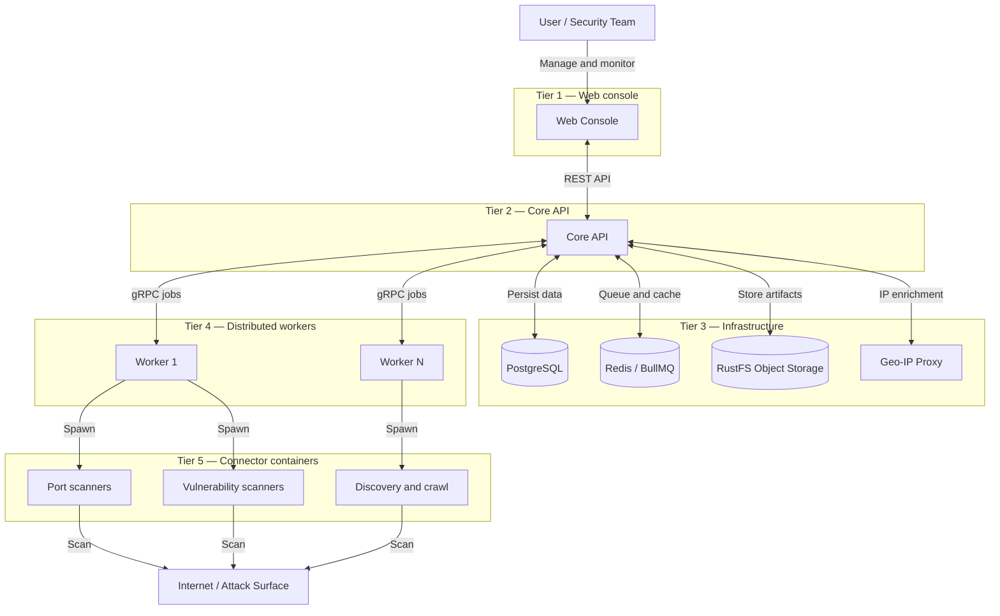

→ Full diagram and scan lifecycle: [docs.oasm.io/architecture](https://docs.oasm.io/architecture)

## Connectors

Scanning tools live as isolated Docker images in the companion repo [oasm-connectors](https://github.com/oasm-platform/oasm-connectors), each wrapping a tool in a small adapter. OASM reads that catalog as data (`task sync-connectors`), so a worker resolves the right image and runs the tool on demand inside its own container — adding or upgrading a scanner never needs an OASM release.

Browse every connector in the [marketplace](https://oasm.dev/marketplace), then install the ones you need from **Tools** in the console.

<table>
  <tr>
    <td align="center" width="72"></td>
    <td align="center" width="72"></td>
    <td align="center" width="72"></td>
    <td align="center" width="72"></td>
    <td align="center" width="72"></td>
    <td align="center" width="72"></td>
    <td align="center" width="72"></td>
  </tr>
  <tr>
    <td align="center" width="72"></td>
    <td align="center" width="72"></td>
    <td align="center" width="72"></td>
    <td align="center" width="72"></td>
    <td align="center" width="72"></td>
    <td align="center" width="72"></td>
    <td align="center" width="72"></td>
  </tr>
</table>

## Integrations

Connect OASM to the tools your team already uses. Integrations are set up per workspace from **Integrations** in the console.

**Alerts — Slack, Discord, Telegram, Webhook**

OASM pushes only the events worth acting on: new vulnerabilities, vulnerability status changes, finished or failed scans, and failed syncs. Each integration chooses which event types and which severity levels it receives.

- **Slack** and **Discord** post to a channel through an incoming webhook.
- **Telegram** uses your own bot. Members link a chat with `/pair` (and `/unpair` to stop). It works through a Telegram webhook, or falls back to polling when the instance has no public URL.
- **Webhook** sends a JSON `POST` to any endpoint, for SIEM, SOAR or in-house tooling.

**Cloud asset sync — AWS, Cloudflare, Vercel**

Pull assets straight from your cloud accounts on a schedule, so new infrastructure lands in the inventory without anyone adding it by hand.

- **AWS:** Route 53 public zones and records, EC2, VPCs and subnets, load balancers, CloudFront, API Gateway, RDS and S3, across regions. Connect with access keys, assume role, cross-account role, workload identity, or AWS SSO sign-in.
- **Cloudflare:** zones and their DNS records.
- **Vercel:** project domains, skipping preview and redirect hosts.

**Source code — GitHub, GitLab**

Add a GitHub or GitLab organization as a target and OASM keeps its repositories in the inventory: new ones are added, renamed ones are followed, and deleted ones are disabled with their history kept. Workflows can scan repositories as soon as a sync finishes. GitHub Enterprise Server and self-managed GitLab are supported.

**Ticketing — GitHub Issues, GitLab Issues**

The same GitHub or GitLab connection can open an issue in a repository you choose for every new vulnerability, so findings land in the backlog your developers already work from. Jira is on the way.

<table>
  <tr>
    <td align="center" width="72"></td>
    <td align="center" width="72"></td>
    <td align="center" width="72"></td>
    <td align="center" width="72"><picture><source media="(prefers-color-scheme: dark)" srcset="docs/images/integrations/webhook-white.svg"></picture></td>
    <td align="center" width="72"><picture><source media="(prefers-color-scheme: dark)" srcset="docs/images/integrations/aws-white.svg">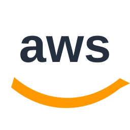</picture></td>
    <td align="center" width="72">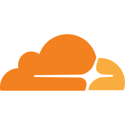</td>
    <td align="center" width="72"><picture><source media="(prefers-color-scheme: dark)" srcset="docs/images/integrations/vercel-white.svg"></picture></td>
    <td align="center" width="72"><picture><source media="(prefers-color-scheme: dark)" srcset="docs/images/integrations/github-white.svg"></picture></td>
    <td align="center" width="72"></td>
  </tr>
</table>

## Screenshots

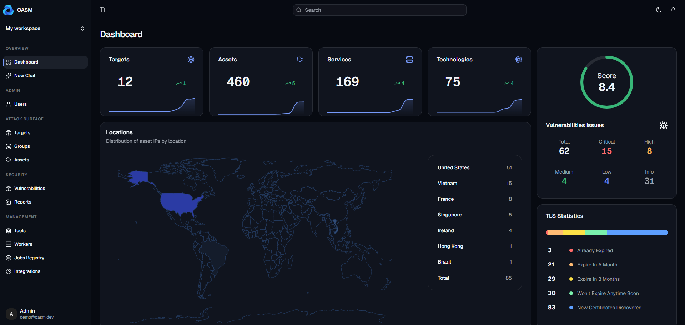
*Dashboard — total counts of targets, assets, services, and technologies, plus the security score, vulnerability breakdown by severity, asset locations on a world map, and TLS certificate expiry stats.*

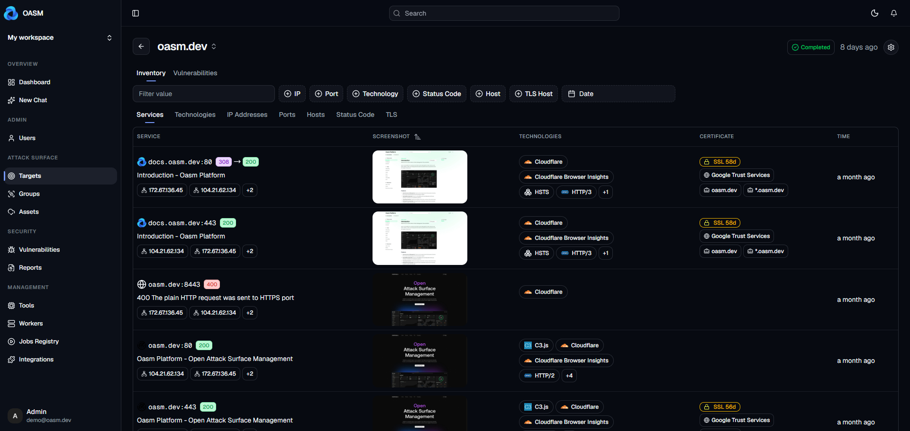
*Target inventory — every discovered service for a target with screenshots, detected technologies, TLS certificate info, and filters by IP, port, technology, status code, host, and date.*

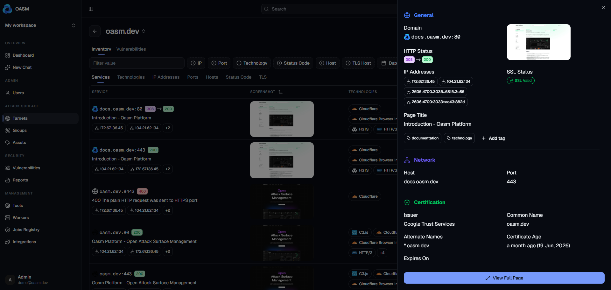
*Asset detail — drill into a single service to see its HTTP status, IP addresses, page title, tags, network info, and full TLS certificate record.*

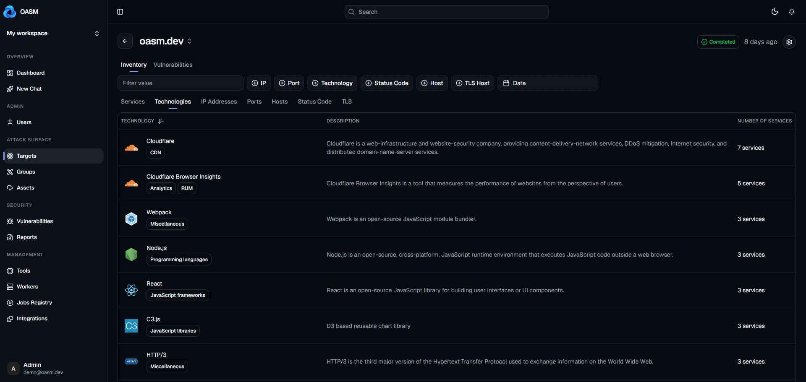
*Technology inventory — frameworks, platforms, and protocols detected across the estate, with descriptions and the number of services using each.*

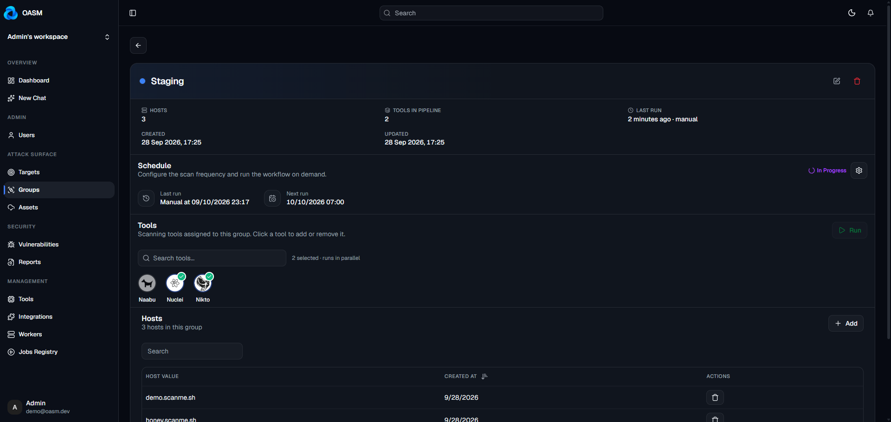
*Asset group — bundle hosts, assign scan tools, set the schedule or run on demand, and track last/next run per group.*

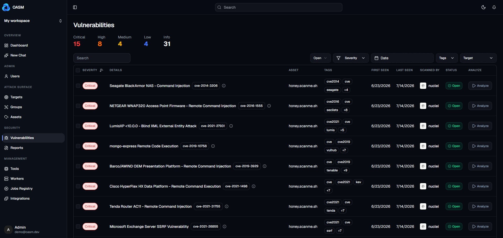
*Vulnerability list — findings grouped by severity with CVE tags, affected asset, first/last seen dates, the scanner that found each one, and status.*

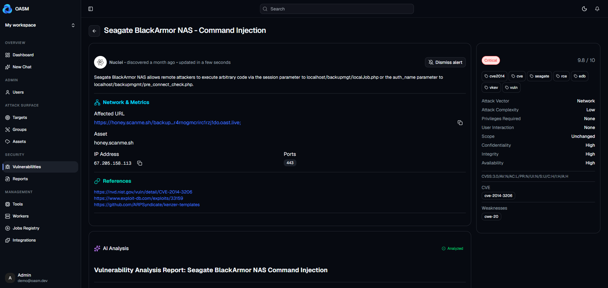
*Vulnerability detail — full write-up of a finding with affected URL, asset, CVSS metrics, CVE/CWE references, and an AI-generated analysis report.*

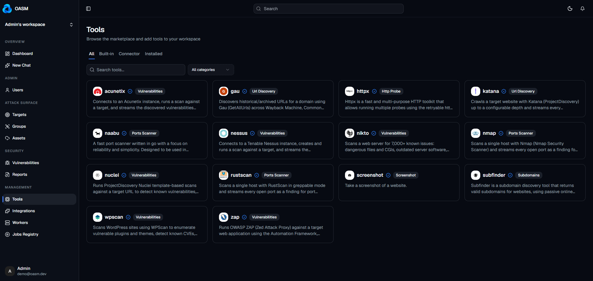
*Tool catalog — install and manage scanners (HTTP probing, port scanning, subdomain discovery, vulnerability scanning) and see which workers carry each tool.*

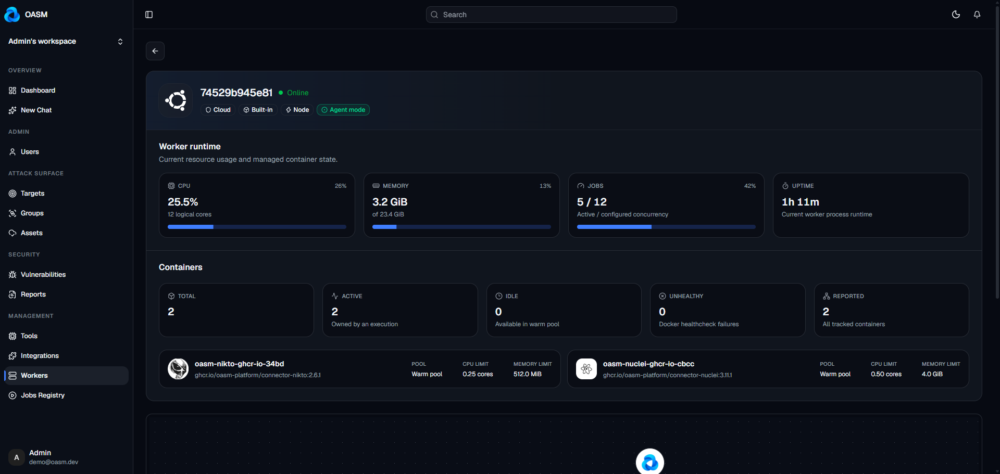
*Worker fleet — online status, installed toolset, and active jobs for every scanning worker across global and workspace scopes.*

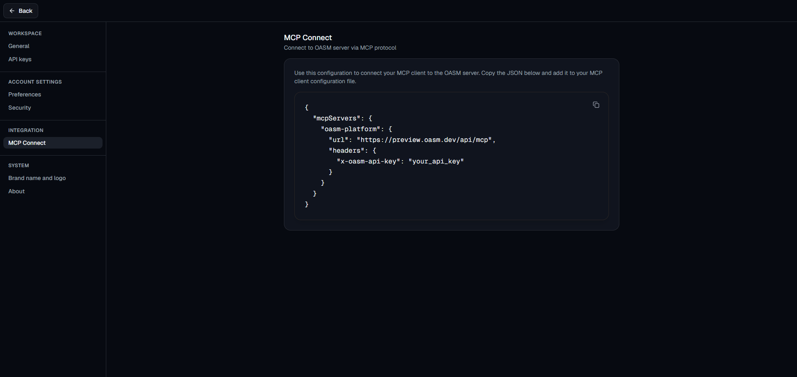
*MCP connect — copy-paste JSON config that plugs any MCP-compatible AI client into your OASM instance via API key.*

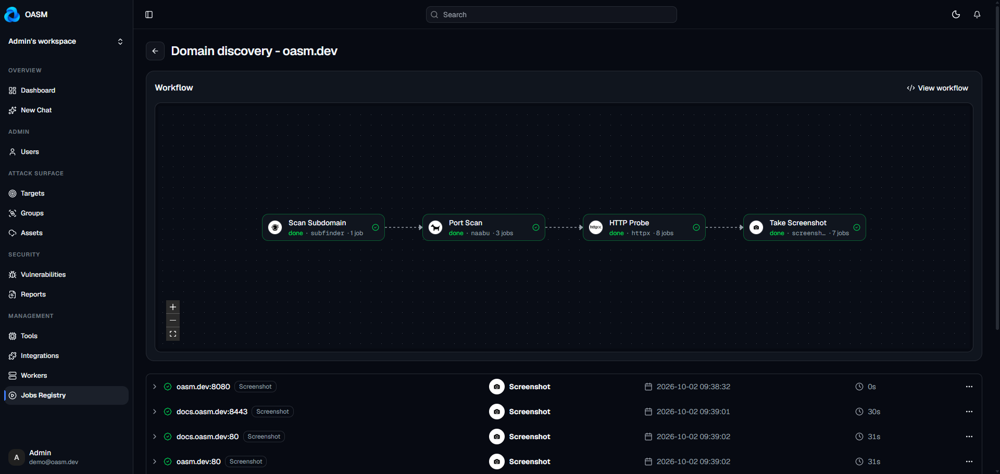
*Job registry — the scan pipeline per target (subdomain discovery → port scan → HTTP probe → screenshot) with per-job status, timing, and history.*

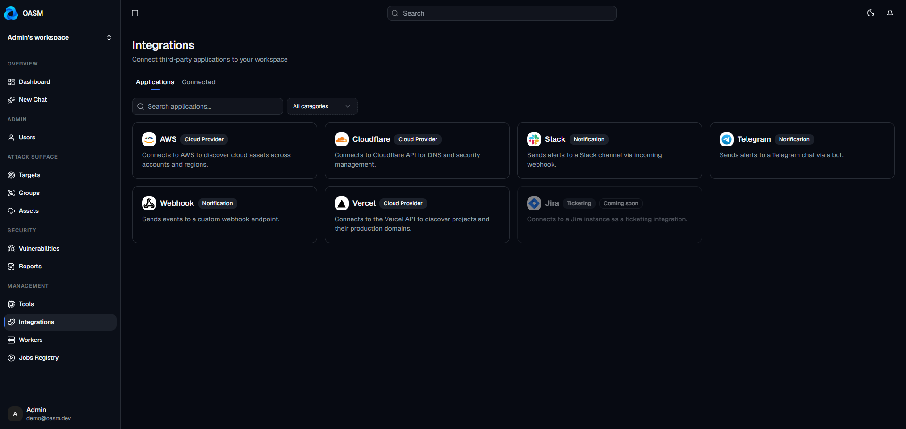
*Integrations — connect alerting (Slack, Telegram, webhook) and cloud providers, with upcoming ticketing and cloud integrations marked.*

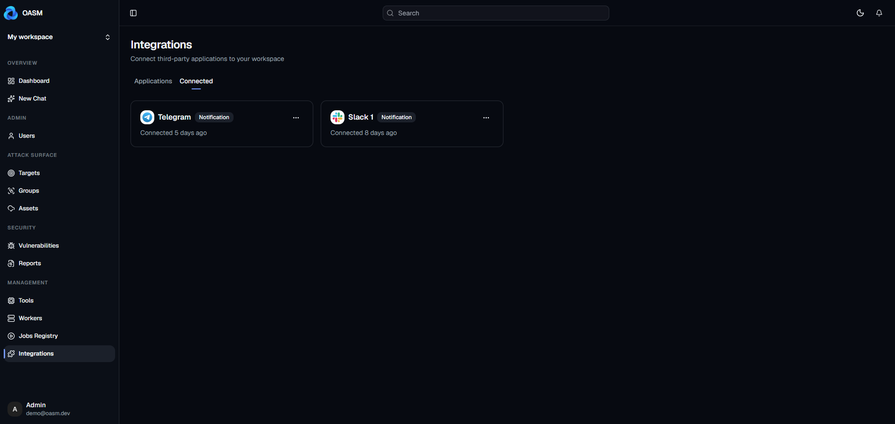
*Connected integrations — manage active third-party connections per workspace and their connection history.*

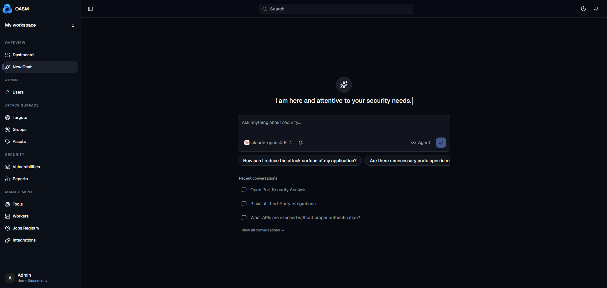
*AI Studio — ask security questions in natural language, pick a model, and revisit recent analysis conversations.*

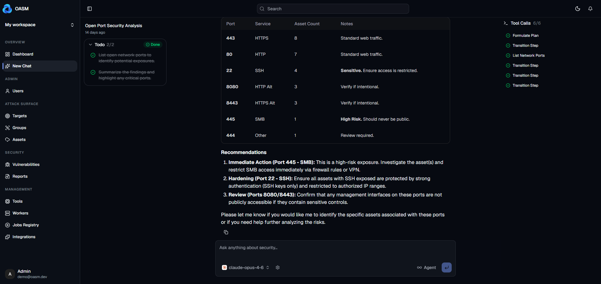
*AI analysis result — the agent plans, queries live asset data, and returns a structured report, e.g. open-port exposure with per-port notes and remediation steps.*

## Quick Start

Prerequisites: Docker + Docker Compose, [Task](https://taskfile.dev/#/installation), Node.js 22, pnpm 10.33.2, Go 1.26 (for local dev).

```bash
git clone https://github.com/oasm-platform/open-asm.git
cd open-asm

cp core-api/example.env core-api/.env
cp console/example.env console/.env
cp worker/.example.env worker/.env   # note the leading dot

task sync-connectors
task docker-compose
```

This starts console, core API, Postgres, Redis, Geo-IP proxy, and RustFS, running pending migrations first via the one-shot `migration` service. Console: `http://localhost:3000`. Scanning workers are opt-in:

```bash
task docker-scan         # start the app and one scanning worker when scans are needed
task docker-status       # inspect running and stopped services
task docker-stop         # stop this project's services, retaining containers and volumes
```

Startup builds only the selected app images using Docker's build cache and reuses
unchanged containers. `task docker-compose` does not build or start the worker,
and does not stop a worker that is already running; inspect `task docker-status` and finish
or cancel scanning work before stopping it. Manually stopped services stay stopped
after Docker restarts (`unless-stopped`). Choose the Docker engine with your normal
Docker context or `DOCKER_CONTEXT`; these tasks do not switch contexts.

| Service | Address |
|---------|---------|
| Console | `http://localhost:3000` |
| Core API | `http://localhost:6276` (gRPC `:16276`, docs `/api/docs`, health `/api/health`) |
| Postgres | `localhost:5432` |
| Redis | `localhost:6379` |
| Geo-IP | `localhost:4360` |
| RustFS | `localhost:9000` (admin UI `:9001`) |
| Worker callback | `:26276` (one worker per host — do not `--scale oasm-worker`) |

Notes:

- Set `WORKER_API_KEY` in `worker/.env` to the key the API expects.
- On native Linux the worker needs the Docker socket group: `task docker-scan` detects `WORKER_DOCKER_GID` automatically. Raw `docker compose --profile scan up` needs `WORKER_DOCKER_GID=$(stat -c '%g' /var/run/docker.sock) docker compose --profile scan up -d`.
- The socket mount is root-equivalent — only run trusted connector images.
- Pre-built images: `oasm/oasm-console`, `oasm/oasm-api`, `oasm/oasm-worker` on Docker Hub.
- Production deploy: [oasm-docker](https://github.com/oasm-platform/oasm-docker) — see [docs.oasm.io/deployment](https://docs.oasm.io/deployment).

## Development

All commands run from the repo root through `task` (raw `npm run` / `go test` bypass RAM limits and transforms).

```bash
task init       # install deps, copy .env templates, start postgres + redis + geo-ip + rustfs
task dev        # API :6276 + Console :5173 with hot-reload
task worker:dev # local Go worker (needs Docker daemon + reachable API/storage)
```

Key commands: `task build`, `task lint` (API then console, sequential — never parallelize), `task test` (API Jest only), `task console:test:run` (Vitest single pass, what CI runs), `task worker:test` / `task worker:test-race`, `task gen-api` (needs booted API; commit `.open-api/*.json` + regenerated client), `task proto` (regenerate Go gRPC stubs), `task migration:generate name=<Name>` + `task migration:run` (never hand-write migrations).

Layout: `core-api/` (NestJS, `src/modules/*`, `src/mcp/`, `src/proto/`), `console/` (React 19 + Vite + TanStack Router/Query, `src/routes/`, orval client in `src/services/apis/gen/`), `worker/` (Go, `internal/*`, entries `cmd/cli` + `cmd/app`).

→ Full setup, conventions, and CI: [DEVELOPER_GUIDE.md](DEVELOPER_GUIDE.md) · [docs.oasm.io/developer-guide](https://docs.oasm.io/developer-guide)

## Contributing

See [`CONTRIBUTING.md`](CONTRIBUTING.md) for the full process. Short version:

1. Fork, branch (`git checkout -b feat/scope-name`), follow [Conventional Commits](https://www.conventionalcommits.org/) (`feat|fix|hot-fix|perf|chore|docs|style|refactor|test|ci(scope):`) — enforced by `commit-msg`.
2. Run `task lint` and relevant tests before pushing (`task api:test`, `task console:test:run`, `task worker:test`). Pre-commit hook is inert — verification is on you. Never hand-write migrations; never hand-edit generated code.
3. Contract changes: run `task gen-api` (commit spec + client); proto changes: `task proto`; schema changes: only via `task migration:generate name=<Name>` after maintainer approval.
4. Open a PR with issue templates (`.github/ISSUE_TEMPLATE/`): bug reports and feature requests welcome — especially new connectors, docs, tests, and supported security workflows.

## Security

See [`SECURITY.md`](SECURITY.md). Short version: report sensitive vulnerabilities via [private Security Advisories](https://github.com/oasm-platform/open-asm/security/advisories/new) — no dedicated email, no formal SLA. Non-sensitive hardening ideas can go in a public [bug report](https://github.com/oasm-platform/open-asm/issues/new?template=bug-report.yml).

## Community and Resources

- Repository: [github.com/oasm-platform/open-asm](https://github.com/oasm-platform/open-asm)
- Issues: [open-asm/issues](https://github.com/oasm-platform/open-asm/issues) (bug-report + feature-request templates)
- Releases: [open-asm/releases](https://github.com/oasm-platform/open-asm/releases)
- Docs: [docs.oasm.io](https://docs.oasm.io)
- Connectors repo: [oasm-platform/oasm-connectors](https://github.com/oasm-platform/oasm-connectors)
- Marketplace: [oasm.dev/marketplace](https://oasm.dev/marketplace)
- Discord / LinkedIn / X: see badges at the top.

## License

[GNU General Public License v3.0](LICENSE) — see `LICENSE` in the repo root.

## Star History

If OASM is useful to you, please star the repo — it helps others discover the project.

[](https://www.star-history.com/?repos=oasm-platform%2Fopen-asm&type=date&legend=top-left)

## Sponsors

OASM is supported by [Anthropic](https://www.anthropic.com) through its startup program. Thank you for backing open-source security tooling.
